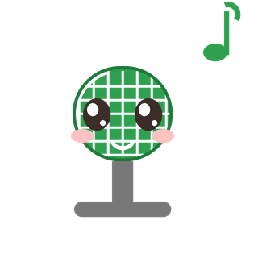

<p align="center">
  
  
</p>

<h1 align="center">MicSwitcher 🎤</h1>

<p align="center">
  <b>谁在说话，就用谁。</b><br>
  一个常驻托盘的 Windows 麦克风切换工具：手动一键切、自动按声音切、还能锁死不让别人抢。
</p>

<p align="center">
  
  
  
  
  
</p>

---

## 😩 你是否也有这些烦恼？

- 打游戏用桌面麦，开会换耳机麦，**每次都要点开 Windows 声音设置翻半天**；
- 桌面上插着三四个麦克风，系统**永远默认到错的那个**，说话对方听不见；
- 手机当麦克风（Mic You / VB-Cable 之类），插上电脑**认不出该用哪个**，来回手动切；
- 想静音得先找到设置窗口——等你找到，话已经说完了；
- 装了会议软件后，它**偷偷把默认麦改成别的**，你毫不知情；
- 剪视频 / 直播时不小心把系统声音录进去，忘了关麦……

**MicSwitcher 就是为这些事写的。**

它常驻在系统托盘，随时可以：

| | |
|---|---|
| 🖱 **一键切麦** | 托盘右键 → 选设备，立刻生效，所有程序一起跟随 |
| 🤖 **自动切换** | 谁在说话就切到谁；或者「插上新麦克风就切过去」 |
| 🔒 **锁定麦克风** | 锁住当前麦克风，被 Windows 或其他软件改动会**立刻改回来** |
| 🎤 **静音开关** | 托盘 / 快捷键随时静音，托盘图标会变灰带红杠 |
| ⌨️ **全局热键** | 默认 `Ctrl+Alt+M` 静音、`Ctrl+Alt+N/P` 切麦，**键位可自定义** |
| 🚀 **开机自启** | 登录即用，还能设置「延迟启动」等音频服务就绪 |
| 🎚 **灵敏度可调** | 静音阈值 / 防抖次数 / 采样间隔 都能拖滑杆调 |
| 🏷 **设备别名 + 排除** | 给设备起短名字；把不想用的设备直接排除 |

---

## ✨ 它凭什么能用

市面上不少「自动切麦」工具切不到虚拟声卡，是因为踩了同一个坑：

> `IAudioMeterInformation.MasterPeakValue` 只反映「**有没有客户端在使用这个端点**」，
> 虚拟声卡（VB-Cable / Voicemeeter 的 `CABLE Output`）在没有程序采集时会**一直报 0**。

MicSwitcher 改成**对每个设备开一条共享模式的 `WasapiCapture`，直接从音频缓冲区算峰值**，
所以虚拟声卡和真实麦克风**一视同仁**，谁响切谁。

另外还有两个细节：

- **默认设备失效兜底**：当前默认麦克风被禁用 / 拔掉时，立刻按优先级切到可用的（不等电平），
  避免「默认麦已经死了 → 新麦读不到电平 → 永远不切换 → 整机没输入」的死锁；
- **虚拟声卡优先让位**：都没声音时优先待在**真实设备**上，虚拟声卡真来声音了再切过去。

---

## 📥 下载安装

1. 到 [Releases](../../releases) 下载最新的发布包；
2. 解压到**任意普通目录**（桌面、`D:\MicSwitcher` 都行）；
3. 双击运行，右下角托盘会出现绿色麦克风图标。

> 📌 **首次运行如果托盘没有图标**，99% 是因为程序放在了带「低完整性」标签的目录
> （某些沙箱 / 同步目录会这样）。把文件夹复制到桌面再跑即可，详见 [常见问题](#-常见问题)。

---

## 🚀 快速上手

```
托 盘 图 标
├─ 🎤 <当前麦克风>            ← 只看
├─ 切换麦克风 ▸               ← 设备列表，打勾的就是当前
├─ 下一个麦克风
├─ 🎤 静音当前麦 / 🔇 取消静音
├─ 模式 ▸  手动 / 自动·按声音 / 自动·按新设备 / 锁定当前麦
├─ 🚀 开机自启
├─ ⚙ 设置…
└─ ❌ 退出
```

双击托盘图标（或再启动一次程序）可以唤出主窗口：

- **左侧**：手动 / 自动两个互斥开关，以及自动策略、锁定开关
- **右侧**：麦克风卡片列表，`▲▼` 调顺序，`⠿` 按住可拖动排序
- **左下角**：`⚙ 设置`，里面是启动 / 托盘 / 通知 / 灵敏度 / 快捷键 / 设备管理 / 关于

---

## 🛠 从源码构建

需要 **.NET 8 SDK**（Windows）。

```bat
build.cmd    :: 编译
test.cmd     :: 单元测试
run.cmd      :: 编译并启动
```

产物在 `MicSwitcher.App\bin\Debug\net8.0-windows\`。

开发笔记、架构说明、以及这一路踩过的坑都在 [docs/DEVELOPMENT.md](docs/DEVELOPMENT.md)。

---

## ❓ 常见问题

<details>
<summary><b>托盘图标不显示 / 开机自启失败</b></summary>

程序所在目录被打了**低完整性标签**（`Mandatory Label\Low`），
从这种目录启动的 exe 继承低权限，Windows 会拒绝它注册托盘图标、写注册表 `Run` 键。

确认：命令行执行 `icacls "程序目录"`，看有没有 `Mandatory Label\Low`。
解决：把程序复制到桌面等普通目录再运行（或 `icacls "目录" /setintegritylevel Medium /T`）。
</details>

<details>
<summary><b>自动模式切不到虚拟声卡</b></summary>

老版本用系统峰值表，虚拟声卡恒为 0。现版本已改成自己开采集流实测，应该正常。
如果仍不行，看看程序目录下 `tray-diag.log` 里的「电平跟踪」行，会打印每个设备的实时电平。
</details>

<details>
<summary><b>两个麦克风来回抢</b></summary>

检查是否有别的切麦工具（旧脚本、其他托盘软件）同时在跑——两个程序会互相拉锯。
</details>

<details>
<summary><b>热键没反应</b></summary>

设置 → 全局快捷键 里会显示每个热键的注册状态。
显示「注册失败」说明被别的程序占用了，换一个组合键即可（支持直接按键录制）。
</details>

---

## 💛 支持这个项目

如果它帮到了你，**点个 ⭐ Star 就是最好的支持**！

- ⭐ [给个 Star](../../stargazers)
- 🐛 [反馈问题 / 提建议](../../issues)
- 🔀 欢迎 PR

---

## 🙏 致谢

- [SoundSwitch](https://github.com/Belphemur/SoundSwitch) —— `IPolicyConfig` 设置默认设备的用法参考
- [MicMute](https://github.com/itsnateai/MicMute) —— 托盘 + 热键静音的思路
- [H.NotifyIcon](https://github.com/HavenDV/H.NotifyIcon) —— WPF 托盘库
- [CC Switch](https://github.com/farion1231/cc-switch)、[Cherry Studio](https://github.com/CherryHQ/cherry-studio) —— 托盘 + 开机自启 + 关闭最小化 的产品形态参考
- [Ghost Downloader](https://github.com/XiaoYouChR/Ghost-Downloader-3) —— 设置页布局参考
- [NAudio](https://github.com/naudio/NAudio) —— 音频设备枚举与采集

---

## 📄 License

[MIT](LICENSE) © nian

<p align="center">
  
  <br>
  <sub>祝你每次开口，麦克风都是对的 🎤</sub>
</p>
